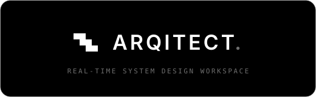

<p align="center">
  
</p>

<p align="center">
  Real-time collaborative system-design workspace  :  turn architecture conversations into an editable canvas and implementation-ready Markdown specs.
</p>

<p align="center">
  <code>Next.js 16</code> · <code>React 19</code> · <code>TypeScript</code> · <code>Clerk</code> · <code>Prisma + Postgres</code> · <code>Liveblocks + React Flow</code> · <code>Trigger.dev</code> · <code>Vercel Blob</code>
</p>

---

## What it does

Sign in, create a project, and start from a blank canvas, a starter architecture template, or an AI prompt. Collaborate on a live Liveblocks + React Flow canvas, let the AI co-architect draft nodes and edges, then generate a versioned Markdown spec from the design.

## Quick start

```bash
npm install
npx prisma generate
npx prisma migrate deploy
npm run dev          # Next.js app
npm run trigger:dev  # Trigger.dev workers (AI design + spec generation)
```

Set env vars first  :  see [Getting started](./docs/getting-started.md).

## Developer docs

- [Docs index](./docs/README.md)
- [Getting started](./docs/getting-started.md)  :  install, env, Prisma, local servers
- [Architecture](./docs/architecture.md)  :  boundaries, state layers, main flows
- [API and data](./docs/api-reference.md)  :  routes, Trigger tasks, Prisma models
- [Contributing](./docs/contributing.md)  :  repo rules, docs, verification

The broader product contract (full feature scope, metadata schema, review model) lives in [`context/`](./context).

## Commands

```bash
npm run dev          # start the app
npm run trigger:dev  # start background workers
npm run build        # production build
npm run lint         # eslint
npx tsc --noEmit     # type check
```

There is no `npm test` script. Tests are `node:test` files beside the code they cover (`lib/`, `types/`, `components/landing/`); run one with `npx tsx --test <file>`.
