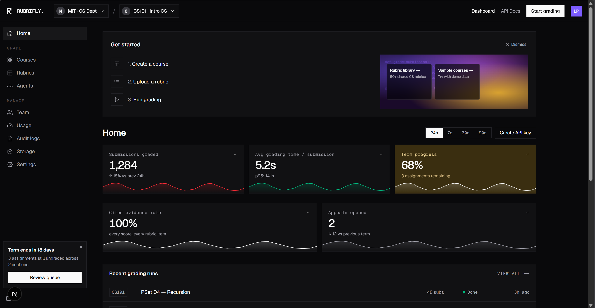

Now lets update our dashbord design. I have provided you an inspiration

From this the manage ones seem relevant and we should keep them as coming soon page till we design them. Keep them in the dashbord.

- designs
- templates
- Agents

For the main dashbord analytics. think and analyze our system and a person who come sto use our platform what do they want to see in the dashbord. 

When they click designs we should show them a card containing their designs in modern, tech first and well designed way. And there should be a button which they can click to start a new deisgn. Try to match the feel, and modern design of the inspiration, while respecting our system property and design systems.

If a part is not implmented, create an empty page for it and put coming soon so that we can implment it as we go.
