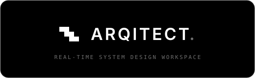

<p align="center">
  
</p>

# Arqitect Developer Docs

Arqitect is a Next.js 16 system-design workspace: authenticated projects, a Liveblocks + React Flow canvas, AI-assisted canvas generation, and Markdown spec generation through Trigger.dev.

These docs describe the current implementation in this repo. The broader product contract lives in `context/`.

## Start Here

- [Getting started](./getting-started.md) - install, env, Prisma, local servers, checks.
- [Architecture](./architecture.md) - boundaries, state layers, app flows.
- [API and data](./api-reference.md) - route handlers, Trigger tasks, Prisma models.
- [Contributing](./contributing.md) - repo rules, docs, verification.

## Useful Commands

```bash
npm run dev
npx tsc --noEmit
npm run lint
npm run build
npm run trigger:dev
```

There is no `npm test` script yet. Existing tests are TypeScript `node:test` files beside the code they cover.
